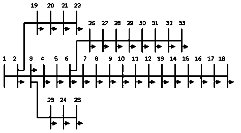
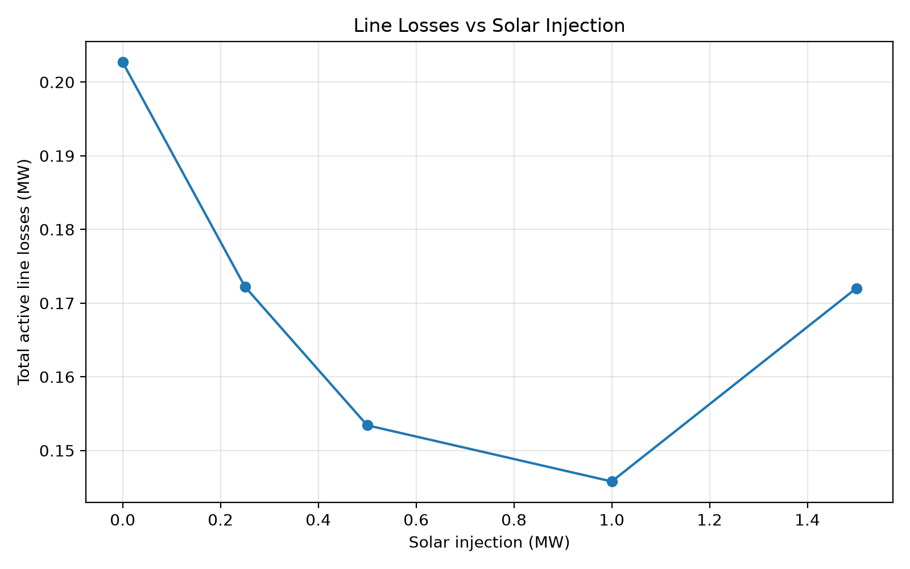
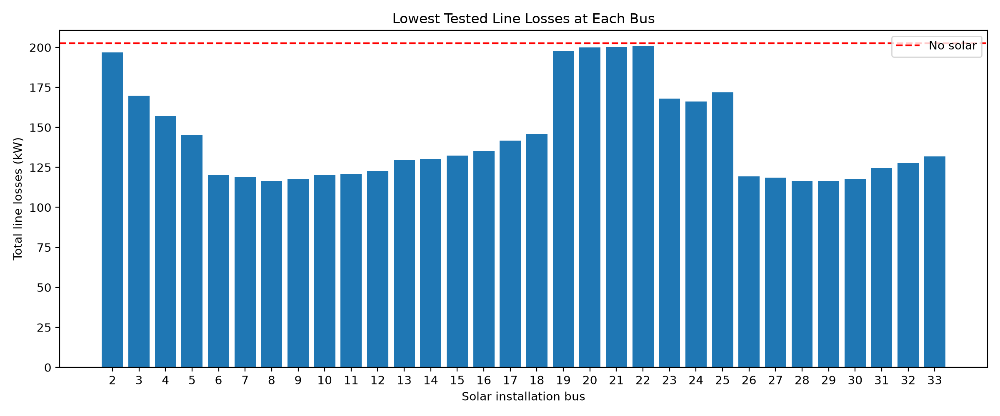

# IEEE 33-Bus Distribution Network Study

I used Python and pandapower to see how electricity demand and solar generation affect the voltages and losses in a distribution network. I started with the standard IEEE 33-bus feeder and then tested different solar locations.



*The buses are numbered 1–33 here. In the Python scripts, Bus 18 is index 17.*

## Experiments

| Experiment | What I tested |
| --- | --- |
| 1. Load growth | Original demand, then 125%, 150% and 175% |
| 2. Solar at Bus 18 | 0, 0.25, 0.5, 1 and 1.5 MW |
| 3. Solar placement | Four solar sizes (0.25, 0.5, 1 and 1.5 MW) at every bus from 2 to 33 — 128 cases |

## Results

**Load growth:** Increasing demand made the voltage drop worse and raised line losses. At 100% demand, the lowest voltage was 0.9131 p.u. and line losses were 202.7 kW. At 175%, these changed to 0.8364 p.u. and 708.7 kW.

**Solar at Bus 18:** With 1 MW of generation, line losses decreased from 202.7 kW to 145.8 kW (about 28% lower). Increasing the output to 1.5 MW raised the losses again. Some buses still had low voltages.



**Comparing all buses:** I then ran 128 bus-and-size combinations. The lowest line loss I found was **116.4 kW at Bus 29 with 1.5 MW solar**, about **42.6% below the no-solar case**. Bus 8 with 1.5 MW was very close at 116.5 kW.



There's a catch: even at Bus 29, the minimum voltage was **0.9357 p.u.**, with **7 buses below 0.95 p.u.** None of the 128 cases met the entire 0.95–1.05 p.u. voltage range. So the lowest-loss option is **not** a voltage-compliant design.

The exact figures are saved in [the results CSV files](results/), including [all 128 placement cases](results/solar_placement_results.csv).

## How to run

Install the Python packages:

```bash
python -m pip install -r requirements.txt
```

Run these from the main project folder:

```bash
python src/baseline.py
python src/load_growth_analysis.py
python src/solar_integration.py
python src/solar_optimization.py
```

Each script saves its results in `results/`. The last script prints a table of all 128 cases and makes the bar chart shown above.

## Notes

This is a **steady-state power-flow study**, not a physical solar installation. I modelled solar as a fixed active-power injection at unity power factor, and used 0.95–1.05 p.u. as the voltage reference for comparison. I haven't tested inverter dynamics, changing sunlight, or equipment thermal limits.

The best result is only the best **among the four solar sizes tested at each bus**, not a proven global optimum. I also haven't tried multiple solar generators or reactive-power control yet.

More background and the experiment notes are in [docs/findings.md](docs/findings.md).
