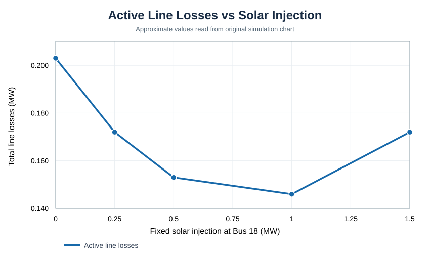
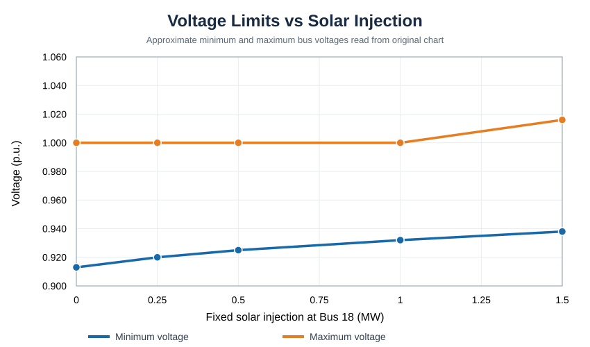

# IEEE 33-Bus Distribution Network — Load Growth & Solar Integration

**Python / pandapower | Steady-state AC power-flow study | Ongoing project**

This project uses the standard IEEE 33-bus distribution feeder to explore two questions:

1. How do increased electrical loads affect voltage profiles and active line losses?
2. How does distributed solar generation at one feeder bus change network voltages and losses?

The project is a **simulation and analysis of a benchmark network**; it is **not** a physical grid deployment or a new optimization algorithm.

## Results from the current simulations

For solar injection at **conventional Bus 18** (pandapower index `17`), with fixed unity power factor:

| Solar injection | Approx. total line loss |
| ---: | ---: |
| 0 MW | 0.203 MW |
| 0.25 MW | 0.172 MW |
| 0.50 MW | 0.153 MW |
| **1.00 MW** | **0.146 MW** |
| 1.50 MW | 0.172 MW |

Numbers above are **rounded readings from the original project plots**. Run the script locally to generate the full-precision `results/solar_integration_results.csv`.

Among the **five tested solar outputs**, 1 MW produced the lowest active line loss, approximately **28% lower** than the no-solar case. At 1.5 MW, losses increased again. However, the network's minimum voltage remained below the **illustrative** 0.95 p.u. lower reference, so the solar injection did not resolve every voltage violation.

This is a selected scenario result, **not proof that 1 MW or Bus 18 is globally optimal**.

### Solar integration trends (digitized approximately from original figures)




*The SVG summaries use rounded values read from original plots. Running the Python scripts regenerates the complete high-resolution voltage-profile and line-loss figures and exports full-precision CSV data.*

## Reproduce the study

1. Install Python and clone/download this repository.
2. From the project folder, install dependencies:

   ```bash
   python -m pip install -r requirements.txt
   ```

3. Run the analyses:

   ```bash
   python src/baseline.py
   python src/load_growth_analysis.py
   python src/solar_integration.py
   ```

Each script prints its numerical results, writes CSV outputs into `results/`, and saves plots under `results/figures/`. Use the generated CSV files for exact figures rather than values estimated by eye from the example charts.

## Study design

| Experiment | Inputs | Main outputs |
| --- | --- | --- |
| Base case | Original `pandapower.networks.case33bw()` | Voltage profile, weakest bus, total line losses |
| Load growth | 100%, 125%, 150%, 175% of baseline active and reactive loads | Lowest bus voltage, buses below 0.95 p.u., line losses |
| Distributed generation | 0, 0.25, 0.50, 1.00, 1.50 MW at Bus 18 | Bus voltage profiles, voltage limits, line losses, grid import |

**Assumptions and boundaries:**

- Balanced, steady-state AC load-flow analysis with `pandapower.runpp`.
- Original 33-bus feeder topology and line parameters from `case33bw()`.
- Load growth multiplies **both active and reactive demand** by the same factor.
- Solar represented by `create_sgen(p_mw=..., q_mvar=0)` — a **fixed active-power injection**, not a weather-driven PV panel or inverter transient model.
- 0.95–1.05 p.u. is used as a **study reference**, not a claim about a specific utility's binding voltage standard.
- Bus indices in pandapower are zero-based; index 17 corresponds to conventional Bus 18.
- Comparing different generator buses, checking feeder line ratings, optimization, weather profiles, and dynamic controls are **future work**, not completed analyses.

## Repository layout

```text
src/
  baseline.py                # Benchmark power flow
  load_growth_analysis.py    # Four load-demand scenarios
  solar_integration.py       # Five solar-output scenarios at Bus 18
results/
  figures/                  # Approximate summary SVGs plus charts regenerated by scripts
docs/
  findings.md               # Interpretation, caveats, and next steps
requirements.txt
README.md
```

## Next work

- Verify numerical results and dependencies on a clean installation (scripts are syntax-checked but have not been rerun in the publishing environment).
- Compare candidate bus locations and finer solar-capacity increments.
- Define an explicit, feasible objective with voltage and line-loading constraints.
- Investigate the possibility of solar output variability and reactive-power support.

**Status:** Load-growth and single-location solar-injection experiments completed; placement/sizing optimization not yet performed.