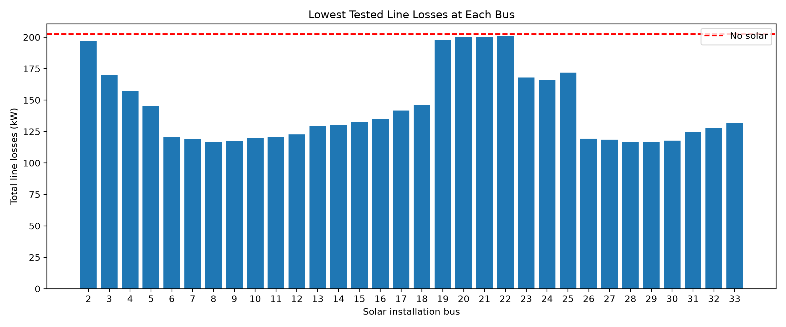

# Experiment notes

These are the results from the Python scripts in this repository. I used `pandapower.networks.case33bw()` and `pp.runpp()` for steady-state AC load flow.

## Experiment 1: increasing the demand

I multiplied both active (P) and reactive (Q) load by the same factor, so the original load power factors stayed the same.

| Demand | Lowest bus voltage | Line losses | Buses below 0.95 p.u. |
| ---: | ---: | ---: | ---: |
| 100% | 0.9131 p.u. | 202.7 kW | 21 |
| 125% | 0.8889 p.u. | 329.9 kW | 21 |
| 150% | 0.8634 p.u. | 496.4 kW | 21 |
| 175% | 0.8364 p.u. | 708.7 kW | 23 |

The weakest-voltage bus was Bus 18 throughout this experiment. A constant count of low-voltage buses doesn't mean the voltages aren't getting worse.

[Full table](../results/load_growth_results.csv)

## Experiment 2: solar added at Bus 18

Solar was modelled with `pp.create_sgen()` using `q_mvar=0`.

| Solar output | Line losses | Lowest voltage | Buses below 0.95 p.u. |
| ---: | ---: | ---: | ---: |
| 0 MW | 202.7 kW | 0.9131 | 21 |
| 0.25 MW | 172.2 kW | 0.9207 | 18 |
| 0.5 MW | 153.4 kW | 0.9245 | 15 |
| 1.0 MW | 145.8 kW | 0.9316 | 6 |
| 1.5 MW | 172.0 kW | 0.9379 | 5 |

Among these five outputs, 1 MW gave the lowest line losses (about 28.1% below baseline). More generation did not always reduce losses. With solar at Bus 18, the weakest bus also shifted to Bus 33, showing why a network-wide comparison matters.

[Full table](../results/solar_integration_results.csv)

## Experiment 3: comparing all solar locations

I tried Buses 2–33, excluding the main grid/slack bus, at four solar outputs: 0.25, 0.5, 1 and 1.5 MW. That made 128 separate power-flow cases. I reused the same network model, changing only the generator bus and active-power output between runs.

- Lowest line losses among the tested cases: **Bus 29, 1.5 MW, 116.384 kW**.
- Reduction from 202.677 kW baseline: **42.6%**.
- Very close result: **Bus 8, 1.5 MW, 116.499 kW**.
- Minimum voltage for Bus 29 / 1.5 MW: **0.9357 p.u.**, with **7 buses below 0.95 p.u.**
- **No tested case** met 0.95–1.05 p.u. at every bus.

So Bus 29 at 1.5 MW is the lowest-loss case in this grid search, **not** an acceptable final design under the voltage reference. The bar chart shows the minimum loss achieved at each bus from the four outputs I tested.

[All 128 cases (CSV)](../results/solar_placement_results.csv)

## Assumptions and limitations

- IEEE 33-bus feeder from pandapower, using a steady-state AC power-flow calculation.
- Demand is scaled proportionally in Experiment 1.
- Solar is represented as fixed active power with `q_mvar=0`. This isn't a solar-cell, irradiance, battery or inverter dynamics model.
- The 0.95–1.05 p.u. band is a **chosen study reference**, not an asserted local utility requirement.
- Experiment 3 records the maximum calculated line current, but does not establish thermal compliance: line ampacity ratings have not been independently validated. Transformer limits, protection coordination and short-circuit performance were not assessed.
- Only four solar sizes were tested. This doesn't establish a mathematically optimal capacity or the best solution under all engineering constraints.

## Possible next work

I could test more solar sizes near the lowest-loss cases, look at reactive-power support or try more than one installation site. Those aren't part of the completed experiments yet.
